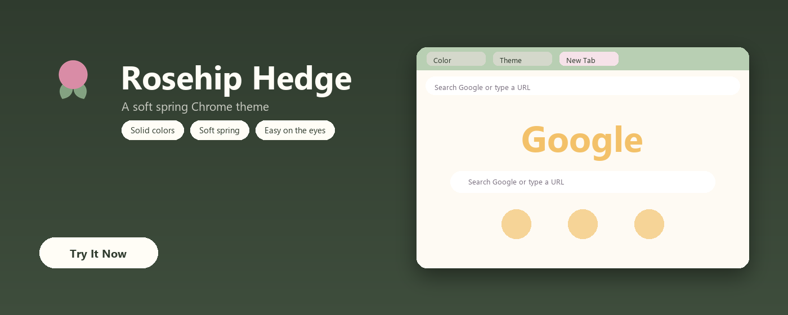
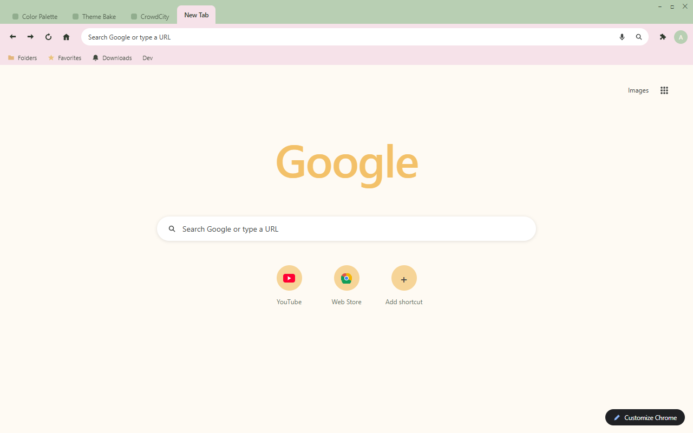
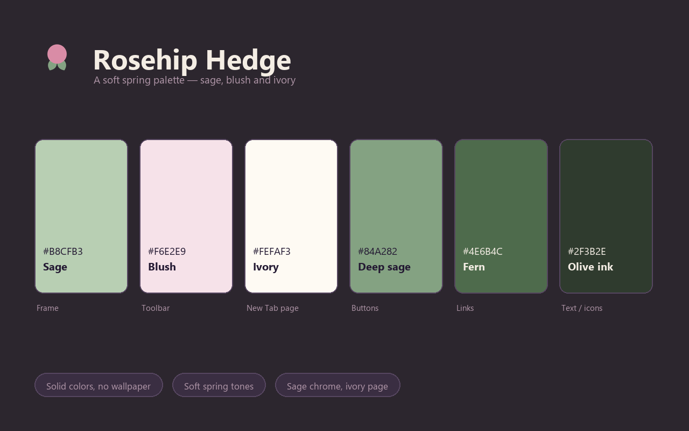

<p align="center">
  
</p>

<h1 align="center">Rosehip Hedge Theme</h1>

<p align="center">
  A soft spring Chrome theme: sage chrome, a blush toolbar, and an ivory New Tab Page.
</p>

<p align="center">
  
  
  
  
</p>

<p align="center">
  
</p>

## Overview

Rosehip Hedge is a hedgerow in early spring: a sage frame across the top, a blush toolbar under it, and an ivory New Tab Page where a warm gold Google mark sits like a low sun. Deep olive ink keeps every tab, bookmark and toolbar icon readable on the light chrome, the two sage tones carry buttons and links, and the only saturated colour is the rosehip in the icon.

## Design Concept

The reference palette is four horizontal bands — blush, ivory, light sage, deep sage. Two of them are pale, so the theme leans on lightness order rather than on hue contrast:

1. **Frame is the deepest of the pale tones** (`#B8CFB3`), the toolbar takes the blush (`#F6E2E9`), the page goes to near-white ivory (`#FEFAF3`) — three clearly separated surfaces.
2. **One colour from outside the band set** — deep olive `#2F3B2E` for all chrome ink and page text (7.1:1 on the frame, 12:1+ on the page).
3. **The deepest sage stays small** — only buttons and the New Tab header, never a large surface.

| Color | Hex | RGB | Role |
|---|---|---|---|
| Sage | `#B8CFB3` | 184, 207, 179 | Frame |
| Blush | `#F6E2E9` | 246, 226, 233 | Toolbar |
| Ivory | `#FEFAF3` | 254, 250, 243 | New Tab background |
| Deep sage | `#84A282` | 132, 162, 130 | New Tab header / buttons |
| Fern | `#4E6B4C` | 78, 107, 76 | New Tab links |
| Olive ink | `#2F3B2E` | 47, 59, 46 | Chrome ink / page text |

## Features

- Pure color, no wallpaper — fast and distraction-free
- Soft spring palette: sage, blush, ivory and deep sage
- Light chrome with deep olive ink — 7.1:1 on the frame
- Tab text, bookmark text and toolbar icons all share the same olive ink
- Single-row shortcut row and a colour-matched Google mark for a clean New Tab Page
- No configuration needed — install and enjoy

## Screenshots

| Browser | Palette |
|:-:|:-:|
|  |  |

## Installation

### Load unpacked (development)

1. Download or clone this repository.
2. Open `chrome://extensions` in Chrome.
3. Enable **Developer mode** in the top right.
4. Click **Load unpacked** and select this folder (`rosehip-hedge-theme`).
5. The theme is active immediately.

### Package for the Chrome Web Store

```
chrome://extensions → Pack extension → select this folder → rosehip-hedge-theme.zip
```

Upload the resulting `.zip` to the [Chrome Web Store developer dashboard](https://chrome.google.com/webstore/devconsole).

## Store listing copy

Ready to paste into the store listing (also kept in `store-assets/store-description.txt`):

> Rosehip Hedge is a soft spring Chrome theme: a sage frame, a blush toolbar, and an ivory New Tab Page with a warm gold Google logo. Deep olive ink keeps every tab, bookmark and toolbar icon readable on the light chrome. Solid colors only, no wallpaper.

## Project structure

| File | Purpose |
|---|---|
| `manifest.json` | Theme definition (single-file, inlined `theme` field) |
| `logo/logo.png` | 128×128 store icon (transparent background) |
| `store-assets/promo/440x280.png` | Small promo tile |
| `store-assets/promo/1400x560.png` | Marquee promo tile |
| `store-assets/screenshots/en/screenshot-1-browser.png` | Browser mockup screenshot (1280×800) |
| `store-assets/screenshots/en/screenshot-2-palette.png` | Palette introduction screenshot (1280×800) |
| `store-assets/store-description.txt` | Store listing description |
| `scripts/generate-logo-vector.py` | Render all SVG logo candidates with headless Chromium, export `logo/logo.png` from `SELECTED` |
| `scripts/generate-screenshot-headless.py` | Regenerate the browser mockup via Playwright |
| `scripts/generate-screenshot-2-palette.py` | Regenerate the palette screenshot |
| `scripts/generate-promo.py` | Regenerate both promo tiles (1400×560 window hero, 440×280 dot palette) |
| `LICENSE` | Non-Commercial License (English / 中文) |

## Regenerating assets

Every asset is code-generated, so nothing here is hand-drawn or hand-copied:

```bash
py -3 scripts/generate-logo-vector.py         # candidates + logo/logo.png
py -3 scripts/generate-screenshot-headless.py # store screenshot 1 (browser mockup)
py -3 scripts/generate-screenshot-2-palette.py # store screenshot 2 (palette)
py -3 scripts/generate-promo.py               # promo 440x280 + 1400x560
```

To ship a different icon candidate, change `SELECTED` at the top of `generate-logo-vector.py` and re-run, then re-run the three asset scripts so the promo and screenshots pick up the new logo.

## License

Rosehip Hedge Theme is released under the Non-Commercial License. See `LICENSE` for full text (English / 中文).
